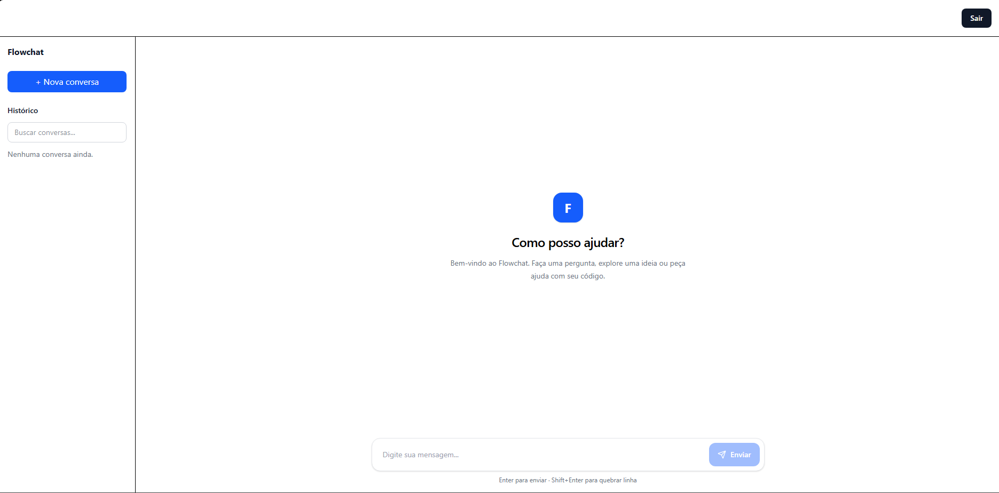

# Flowchat

**Chat com inteligência artificial, respostas em tempo real e histórico persistente.**

O Flowchat é uma aplicação full-stack desenvolvida com Next.js, TypeScript e Google Gemini. O projeto oferece uma experiência de conversação com IA, autenticação via GitHub, histórico de mensagens e recursos de edição e gerenciamento de conversas.

Além da interface, o projeto explora desafios de engenharia como **streaming de respostas, persistência de dados, controle de concorrência, cancelamento de requisições e segurança de APIs**.

### 🌐 Demonstração

**[Acessar o Flowchat](https://flowchat-nu.vercel.app)**

**[Repositório no GitHub](https://github.com/VictorMhub/flowchat)**

## Prévia da aplicação

> Adicione aqui uma captura de tela da interface.



## Funcionalidades

- **Chat com IA:** integração com Google Gemini para geração de respostas.
- **Streaming em tempo real:** exibição progressiva do texto gerado.
- **Cancelamento de respostas:** possibilidade de interromper uma geração em andamento.
- **Autenticação com GitHub:** acesso às conversas por meio de login.
- **Histórico persistente:** armazenamento de conversas e mensagens no PostgreSQL.
- **Gerenciamento de conversas:** criação, seleção, renomeação e exclusão.
- **Edição de mensagens:** edição de mensagens anteriores com regeneração da resposta.
- **Controle de concorrência:** proteção contra operações simultâneas na mesma conversa.
- **Rate limiting:** limitação de requisições com Redis.
- **Interface responsiva:** experiência adaptada a diferentes tamanhos de tela.

## Tecnologias utilizadas

| Camada | Tecnologias |
|---|---|
| Frontend | Next.js 16, React 19, TypeScript |
| Estilização | Tailwind CSS 4 |
| Inteligência artificial | Google Gemini, `@google/genai` |
| Autenticação | Auth.js, GitHub OAuth |
| Banco de dados | PostgreSQL, Neon |
| ORM | Prisma 7 |
| Cache e segurança | Upstash Redis, Upstash Ratelimit |
| Validação | Zod |
| Deploy | Vercel |
| Gerenciador de pacotes | pnpm |

## Arquitetura

O projeto utiliza o **App Router do Next.js** e organiza as responsabilidades entre interface, funcionalidades de chat, serviços de servidor e persistência.

```text
app/
├── (chat)/
│   ├── layout.tsx
│   └── chat/
│       └── page.tsx
└── api/
    ├── auth/
    ├── chat/
    └── conversations/

features/
├── auth/
└── chat/
    ├── components/
    ├── hooks/
    ├── schemas/
    ├── services/
    └── types/

server/
├── ai/
├── auth/
├── db/
└── security/

prisma/
├── schema.prisma
└── migrations/
```
Para mais detalhes sobre os fluxos de dados, streaming e concorrência, consulte a [documentação de arquitetura](./docs/ARCHITECTURE.md).

### Fluxo de uma mensagem

1. O usuário envia uma mensagem pela interface.
2. A API verifica a autenticação e aplica o rate limiting.
3. O servidor adquire um bloqueio Redis para a conversa.
4. A mensagem é registrada no PostgreSQL.
5. O Gemini gera a resposta em streaming.
6. O frontend apresenta os fragmentos recebidos.
7. Ao concluir a geração, o servidor persiste a resposta e libera o bloqueio.

Se a geração for cancelada, a resposta incompleta não é persistida como resposta final.

## Decisões técnicas

### Streaming de respostas

O Flowchat utiliza `ReadableStream` para transmitir progressivamente as respostas do Gemini ao navegador.

Essa abordagem reduz a espera percebida pelo usuário e permite acompanhar a geração em tempo real.

### Cancelamento de requisições

A aplicação utiliza `AbortController` para interromper gerações.

O frontend também gerencia mensagens temporárias, evitando que indicadores como **“Pensando...”** permaneçam visíveis após o cancelamento.

### Controle de concorrência

Operações simultâneas na mesma conversa podem causar inconsistências no histórico.

Para reduzir esse risco, o projeto combina:

- **Bloqueios Redis:** restringem operações concorrentes por conversa.
- **Renovação de bloqueios:** mantém a proteção durante gerações prolongadas.
- **Transações PostgreSQL:** agrupam alterações relacionadas.
- **`generationVersion`:** identifica gerações substituídas por operações mais recentes.
- **Posicionamento de mensagens:** preserva a ordem lógica do histórico.

### Edição de mensagens anteriores

Ao editar uma mensagem, a aplicação utiliza o histórico anterior ao ponto de edição para gerar uma nova resposta.

Após a conclusão, o banco de dados atualiza a mensagem editada e substitui as mensagens posteriores, mantendo a sequência consistente.

### Segurança

A aplicação utiliza autenticação com GitHub, validação de entrada com Zod, verificação de propriedade das conversas e rate limiting.

As credenciais dos serviços são armazenadas em variáveis de ambiente e não devem ser incluídas no repositório.

## Executando localmente

### Pré-requisitos

- Node.js compatível com Next.js 16
- pnpm
- Banco PostgreSQL
- Instância Upstash Redis
- Chave de API do Google Gemini
- Aplicativo GitHub OAuth

### Instalação

Clone o repositório:

```bash
git clone https://github.com/VictorMhub/flowchat.git
cd flowchat
```

Instale as dependências:

```bash
pnpm install
```

### Variáveis de ambiente

Copie o arquivo `.env.example` para `.env.local`:

```bash
cp .env.example .env.local

```dotenv

DATABASE_URL="postgresql://..."
DIRECT_URL="postgresql://..."

GEMINI_API_KEY=""

AUTH_SECRET=""
AUTH_GITHUB_ID=""
AUTH_GITHUB_SECRET=""

UPSTASH_REDIS_REST_URL=""
UPSTASH_REDIS_REST_TOKEN=""
```

> `DIRECT_URL` deve ser configurada caso seja utilizada pela configuração Prisma do projeto. Nunca publique credenciais reais.

Configure o callback do aplicativo GitHub OAuth para o ambiente local:

```text
http://localhost:3000/api/auth/callback/github
```

### Banco de dados

Gere o Prisma Client:

```bash
pnpm exec prisma generate
```

Aplique as migrations existentes:

```bash
pnpm exec prisma migrate deploy
```

### Desenvolvimento

Inicie o servidor:

```bash
pnpm dev
```

Abra:

```text
http://localhost:3000
```

### Build de produção

```bash
pnpm build
pnpm start
```

## Deploy

A aplicação está publicada na **Vercel**, com serviços externos para banco de dados, Redis, autenticação e inteligência artificial.

Para publicar sua própria instância:

1. Importe o repositório na Vercel.
2. Configure as variáveis de ambiente necessárias.
3. Configure o domínio de produção no GitHub OAuth.
4. Execute o deploy e valide os principais fluxos da aplicação.

## Aprendizados

Durante o desenvolvimento, foram trabalhados conceitos como:

- Arquitetura full-stack com Next.js App Router.
- Integração de modelos generativos com streaming.
- Gerenciamento de estado assíncrono no React.
- Autenticação OAuth.
- Modelagem e persistência de dados com Prisma.
- Concorrência e consistência de dados.
- Proteção de APIs e controle de requisições.
- Configuração e publicação em ambiente de produção.

## Possíveis melhorias

- Testes automatizados de integração e concorrência.
- Observabilidade e monitoramento de erros.
- Melhorias de acessibilidade.
- Exportação de conversas.
- Seleção de modelos de IA.

## Autor

Desenvolvido por **VictorMhub**.

[GitHub](https://github.com/VictorMhub)

## Licença

A licença do projeto ainda não foi definida. Consulte o repositório para verificar as condições de uso.