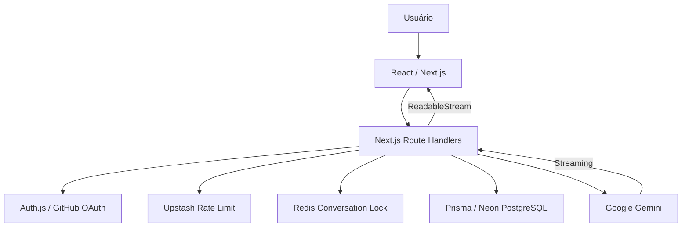
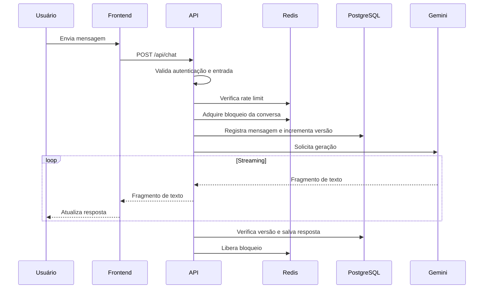

# Arquitetura do Flowchat

## Visão geral

O Flowchat é uma aplicação full-stack construída com Next.js 16 (App Router), React 19 e TypeScript.

A arquitetura separa a interface, a lógica de chat, as rotas de API e os serviços de infraestrutura.

## Diagrama da arquitetura

## Organização do projeto

| Diretório | Responsabilidade |
|---|---|
| `app/` | Páginas, layouts e rotas HTTP |
| `features/chat/components/` | Componentes da interface de chat |
| `features/chat/hooks/` | Estado e operações do chat |
| `features/chat/services/` | Comunicação HTTP com o backend |
| `features/chat/schemas/` | Validação das mensagens |
| `server/ai/` | Integração com Gemini |
| `server/auth/` | Identificação do usuário autenticado |
| `server/db/` | Acesso ao PostgreSQL |
| `server/security/` | Rate limiting e bloqueios Redis |
| `prisma/` | Schema e migrations |

## Fluxo de envio de mensagens

## Cancelamento de geração

O frontend utiliza `AbortController` para interromper a requisição.

O backend recebe o sinal de cancelamento e procura encerrar a geração. Respostas incompletas não são salvas como respostas finais.

O frontend também remove o indicador temporário de carregamento quando a geração é interrompida.

## Controle de concorrência

O Flowchat combina diferentes mecanismos para reduzir conflitos entre operações simultâneas:

- **Redis:** bloqueio temporário por conversa, com token de identificação.
- **Renovação de bloqueio:** prolonga a validade durante gerações demoradas.
- **PostgreSQL:** transações com bloqueio de linha (`FOR UPDATE`).
- **`generationVersion`:** verifica se a geração ainda corresponde à versão atual da conversa.
- **`position`:** mantém a ordem lógica das mensagens.

Quando outra operação já utiliza a conversa, a API pode retornar HTTP `409 Conflict`.

## Edição de mensagens

Ao editar uma mensagem anterior:

1. O backend identifica a mensagem original.
2. Recupera o histórico anterior à edição.
3. Solicita uma nova resposta ao Gemini.
4. Verifica a versão e a consistência do histórico.
5. Atualiza a mensagem editada e substitui as mensagens posteriores.

As alterações são realizadas em uma transação para evitar persistência parcial.

## Segurança

- Autenticação GitHub OAuth com Auth.js.
- Verificação de propriedade das conversas.
- Validação de entradas com Zod.
- Rate limiting com Upstash Redis.
- Credenciais armazenadas em variáveis de ambiente.
- Bloqueio de operações concorrentes por conversa.

## Infraestrutura

| Serviço | Utilização |
|---|---|
| Vercel | Hospedagem da aplicação |
| Neon | PostgreSQL |
| Upstash | Redis |
| Google Gemini | Geração de respostas |
| GitHub OAuth | Autenticação |

## Limitações e melhorias futuras

- Adicionar testes automatizados de integração e concorrência.
- Implementar monitoramento de erros em produção.
- Aprimorar a recuperação de falhas de rede.
- Adicionar testes de acessibilidade.
- Revisar a renovação e a expiração dos bloqueios em operações prolongadas.
